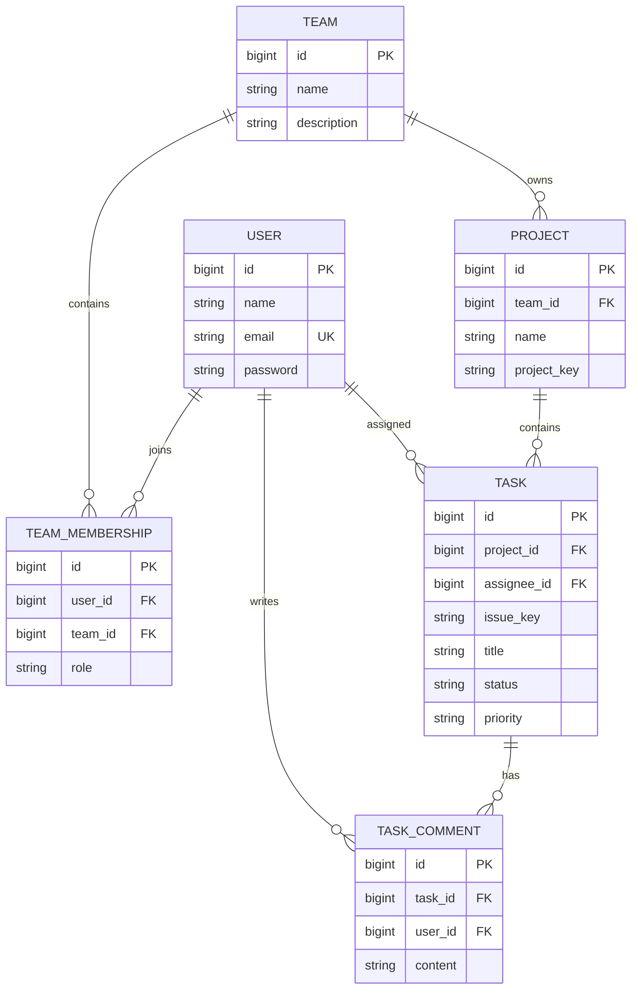
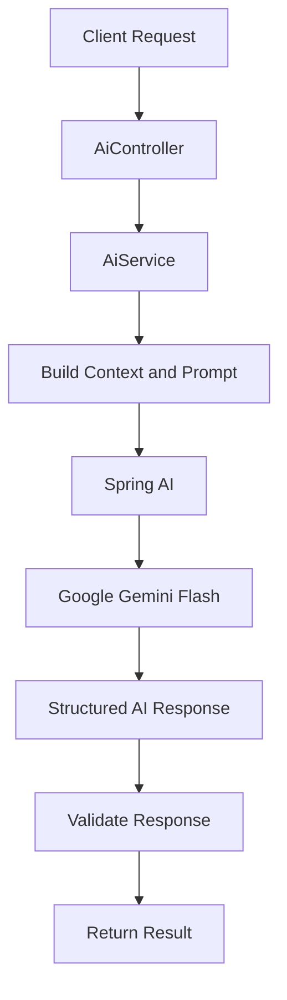

# 🚀 TeamHub — Intelligent Team Collaboration & Project Management

<p align="center">
  <strong>A modern, AI-powered project management backend built for collaborative engineering teams.</strong>
</p>

<p align="center">
  
  
  
  
  
</p>

---

## 📌 Overview

**TeamHub** is a Jira-inspired team collaboration and project management platform designed to simplify how engineering teams organize projects, manage tasks, and collaborate.

Built using **Spring Boot 4, Java 25, PostgreSQL, and Spring AI**, TeamHub combines a modular backend architecture with intelligent AI-powered workflows.

From managing multiple teams and projects to tracking tasks through a Kanban workflow, TeamHub provides the foundation for a centralized engineering workspace.

What makes TeamHub different is its AI integration: users can transform natural-language instructions into structured engineering tasks, summarize lengthy discussions, and filter project boards using conversational queries.

## ✨ Key Features

### 🔐 Authentication & Authorization
- Secure user registration and login.
- Stateless JWT-based authentication.
- BCrypt password hashing.
- Spring Security integration.
- Role-Based Access Control (RBAC).
- Protected API endpoints.

### 👥 Team Management
- Create and manage multiple teams.
- Automatic assignment of team ownership.
- Invite members using their email addresses.
- Manage team membership and permissions.
- Support for OWNER, ADMIN, and MEMBER roles.
- Team-level access boundaries.

### 📁 Project Management
- Create projects within teams.
- Unique project keys for issue identification.
- Organize projects by team.
- Maintain project-level task associations.
- Track project progress through tasks.

### 📋 Task & Kanban Management
- Create, update, and manage tasks.
- Jira-style issue identifiers (e.g., `TH-1`, `TH-2`).
- Configurable task statuses.
- Priority-based task management.
- Assign tasks to team members.
- Update task status and Kanban position.
- Search and filter tasks.
- Support for task comments.

### 🤖 AI-Powered Workflows

TeamHub integrates **Spring AI with Google Gemini Flash** to bring intelligent automation into project management.

| AI Feature | Description |
|---|---|
| Smart Task Drafting | Convert natural-language requirements into structured engineering tasks. |
| Comment Summarization | Extract TL;DR summaries, important decisions, and blockers from discussions. |
| Natural Language Filtering | Convert conversational queries into structured task filters. |

### 🛡️ Backend Reliability
- Centralized exception handling.
- Request validation.
- Database migrations with Flyway.
- Connection pooling using HikariCP.
- Modular package-by-feature architecture.
- API documentation through Swagger UI.

---

## 🛠️ Technology Stack

| Category | Technology |
|---|---|
| Language | Java 25 |
| Backend Framework | Spring Boot 4.1.2 |
| Web Layer | Spring WebMVC |
| Security | Spring Security |
| Authentication | JWT (JJWT 0.12.6) |
| Password Hashing | BCrypt |
| Database | PostgreSQL |
| ORM | Spring Data JPA / Hibernate |
| Database Migration | Flyway |
| AI Integration | Spring AI 2.0.0 |
| AI Model | Google Gemini Flash |
| Connection Pooling | HikariCP |
| API Documentation | SpringDoc OpenAPI |
| Build Tool | Maven |
| Boilerplate Reduction | Lombok |
| Monitoring | Spring Boot Actuator |

---

## 🏗️ Architecture

TeamHub follows a **Package-by-Feature architecture** rather than organizing the entire application into global controller, service, and repository layers.

Each feature maintains its own domain logic, entities, repositories, DTOs, controllers, and services.

This approach improves modularity, maintainability, and separation of responsibilities.

### Project Structure

```text
teamhub-backend/
│
├── src/
│   └── main/
│       ├── java/com/teamhub/teamhub_backend/
│       │
│       ├── TeamhubBackendApplication.java
│       │
│       ├── config/
│       │   ├── SecurityConfig.java
│       │   ├── JwtAuthenticationFilter.java
│       │   ├── CustomUserDetailsService.java
│       │   ├── CorsConfig.java
│       │   └── OpenApiConfig.java
│       │
│       ├── common/
│       │   └── exception/
│       │       ├── GlobalExceptionHandler.java
│       │       ├── ResourceNotFoundException.java
│       │       ├── ConflictException.java
│       │       └── ForbiddenAccessException.java
│       │
│       ├── auth/
│       │   ├── controller/
│       │   ├── dto/
│       │   └── service/
│       │
│       ├── user/
│       │   ├── controller/
│       │   ├── dto/
│       │   ├── entity/
│       │   ├── repository/
│       │   └── service/
│       │
│       ├── team/
│       │   ├── controller/
│       │   ├── dto/
│       │   ├── entity/
│       │   ├── repository/
│       │   └── service/
│       │
│       ├── project/
│       │   ├── controller/
│       │   ├── dto/
│       │   ├── entity/
│       │   ├── repository/
│       │   └── service/
│       │
│       ├── task/
│       │   ├── controller/
│       │   ├── dto/
│       │   ├── entity/
│       │   ├── repository/
│       │   └── service/
│       │
│       └── ai/
│           ├── controller/
│           ├── dto/
│           └── service/
│
│       └── resources/
│           ├── application.properties
│           └── db/migration/
│               ├── V1__create_users.sql
│               ├── V2__create_teams_and_memberships.sql
│               ├── V3__create_projects.sql
│               ├── V4__create_tasks.sql
│               └── V5__create_task_comments.sql
│
├── pom.xml
├── mvnw
├── mvnw.cmd
├── .gitignore
└── README.md
```

---

## 🗄️ Database Design

TeamHub uses PostgreSQL as its primary relational database.

Database schema changes are managed through **Flyway**, ensuring version-controlled and repeatable database migrations.

### Database Modules

| Migration | Description |
|---|---|
| V1 | Users table with unique email constraints and audit timestamps. |
| V2 | Teams and team memberships with role-based access. |
| V3 | Projects associated with teams and unique project keys. |
| V4 | Tasks with statuses, priorities, assignees, and issue numbering. |
| V5 | Task comments for collaborative discussions. |

### Core Domain Relationships



### Task Workflow

**Supported task statuses:**

`TODO` → `IN_PROGRESS` → `IN_REVIEW` → `DONE`

**Supported priorities:**

`LOW` · `MEDIUM` · `HIGH` · `URGENT`

*Issue identifiers are generated using the associated project key, for example `TH-1`.*

---

## 🤖 AI Integration — Spring AI + Gemini

One of TeamHub's core capabilities is its integration with Google's Gemini Flash models through Spring AI.

The AI module provides contextual assistance using project and task information.

### 1. Smart Task Drafting

**Endpoint:**

`POST /api/projects/{projectId}/ai/task-draft`

Transforms a rough task description into a structured engineering specification.

Example input:

```json
{
  "prompt": "Build JWT authentication with refresh token support"
}
```

Expected logical output:

```json
{
  "title": "Implement JWT Authentication",
  "description": "Implement secure authentication...",
  "acceptanceCriteria": [
    "Users can authenticate securely",
    "JWT access tokens are validated",
    "Invalid tokens are rejected"
  ],
  "priority": "HIGH"
}
```

*The example illustrates the intended output; actual response fields follow the backend DTO.*

### 2. Comment Thread Summarization

**Endpoint:**

`POST /api/tasks/{taskId}/ai/summarize`

Analyzes task discussions and extracts:

- Concise discussion summary.
- Important decisions.
- Identified blockers.
- Actionable takeaways.

### 3. Natural Language Task Filtering

**Endpoint:**

`POST /api/projects/{projectId}/ai/filter-tasks`

Allows users to describe the tasks they want to find using natural language.

Example:

```text
Show me high priority TODO tasks related to security.
```

The AI interprets the request and converts it into structured task filters that can be used by the backend.

### AI Architecture



AI operations are integrated with the existing backend authorization and domain logic.

---

## 🔌 REST API Reference

Base URL:

```text
http://localhost:8080/api
```

### Authentication APIs

| Method | Endpoint | Description |
|---|---|---|
| POST | `/auth/register` | Register a new user |
| POST | `/auth/login` | Authenticate an existing user |

### User APIs

| Method | Endpoint | Description |
|---|---|---|
| GET | `/users/me` | Retrieve authenticated user profile |

### Team APIs

| Method | Endpoint | Description |
|---|---|---|
| POST | `/teams` | Create a team |
| POST | `/teams/{teamId}/members` | Add a member to a team |

### Project APIs

| Method | Endpoint | Description |
|---|---|---|
| POST | `/teams/{teamId}/projects` | Create a project |

### Task APIs

| Method | Endpoint | Description |
|---|---|---|
| POST | `/projects/{projectId}/tasks` | Create a task |
| GET | `/projects/{projectId}/tasks` | Retrieve and filter project tasks |
| PATCH | `/tasks/{taskId}` | Update task details, status, position, or assignee |

### AI APIs

| Method | Endpoint | Description |
|---|---|---|
| POST | `/projects/{projectId}/ai/task-draft` | Generate structured task specifications |
| POST | `/tasks/{taskId}/ai/summarize` | Summarize task discussions |
| POST | `/projects/{projectId}/ai/filter-tasks` | Parse natural-language task filters |

*Refer to Swagger UI for request schemas, response structures, authentication requirements, and additional endpoint details.*

---

## ⚙️ Getting Started

Follow these steps to run TeamHub locally.

### Prerequisites

Ensure you have the following installed:

- Java 25 or compatible configured JDK.
- PostgreSQL.
- Maven (optional if using Maven Wrapper).
- Google AI Studio API key (required for AI features).
- Git.

### 1. Clone the Repository

```bash
git clone <YOUR_REPOSITORY_URL>
cd teamhub-backend
```

### 2. Create the PostgreSQL Database

Open PostgreSQL using `psql` or pgAdmin.

```sql
CREATE DATABASE teamhub_db;
```

### 3. Configure Environment Variables

Configure your environment variables before running the application.

Example:

```properties
DB_URL=jdbc:postgresql://localhost:5432/teamhub_db
DB_USERNAME=postgres
DB_PASSWORD=your_database_password

GEMINI_API_KEY=your_google_ai_api_key

JWT_SECRET=your_base64_encoded_256_bit_secret
```

Configure the corresponding placeholders in `application.properties`:

```properties
spring.datasource.url=${DB_URL}
spring.datasource.username=${DB_USERNAME}
spring.datasource.password=${DB_PASSWORD}

spring.ai.google.genai.api-key=${GEMINI_API_KEY}
spring.ai.google.genai.chat.options.model=gemini-2.5-flash

app.jwt.secret=${JWT_SECRET}
```

**Important:**
- Keep your API keys and credentials private.
- Never commit actual secrets to GitHub.
- Generate a strong random JWT secret compatible with your application's JWT configuration.
- Verify the Gemini model name against the model configured in your application.

### 4. Run the Application

Using Maven Wrapper:

**Linux / macOS:**

```bash
./mvnw spring-boot:run
```

**Windows:**

```powershell
.\mvnw.cmd spring-boot:run
```

Alternatively:

```bash
mvn spring-boot:run
```

On startup, Flyway automatically validates and applies pending database migrations.

The backend will be available at:

```text
http://localhost:8080
```

---

## 📖 API Documentation

TeamHub uses SpringDoc OpenAPI to generate interactive API documentation.

After starting the backend, visit:

**Swagger UI:**

http://localhost:8080/swagger-ui/index.html

**OpenAPI Specification:**

http://localhost:8080/v3/api-docs

You can use Swagger UI to:

- Explore available REST endpoints.
- Inspect request and response schemas.
- Test authentication.
- Execute protected endpoints.
- Verify API responses.

---

## 🔒 Security

Security is implemented using Spring Security and JWT-based authentication.

Key security mechanisms include:

- Stateless authentication.
- JWT validation through a custom authentication filter.
- BCrypt password hashing.
- Role-based access control.
- Protected resources.
- Team-level membership and authorization checks.
- Centralized security configuration.

The backend remains the source of truth for all authentication and authorization decisions.

---

## 🧪 Testing

Run the test suite using:

```bash
./mvnw test
```

On Windows:

```powershell
.\mvnw.cmd test
```

Build the application:

```bash
./mvnw clean package
```

Run the generated JAR:

```bash
java -jar target/teamhub-backend-*.jar
```

---

## 🗺️ Roadmap

Potential future improvements:

- [ ] Real-time task updates using WebSockets.
- [ ] Real-time notifications.
- [ ] Advanced project analytics.
- [ ] Task activity timeline.
- [ ] File attachments.
- [ ] Advanced team permission management.
- [ ] AI-assisted project planning.
- [ ] AI-powered sprint planning.
- [ ] Improved AI response streaming.
- [ ] Automated deployment pipeline.
- [ ] Comprehensive integration and performance testing.

---

## 📁 Environment Configuration

A recommended `.gitignore` configuration:

```gitignore
# Environment variables
.env
.env.*
!.env.example

# Build output
target/
build/

# IDE
.idea/
.vscode/
*.iml

# OS
.DS_Store
Thumbs.db

# Logs
*.log
```

---

## 🤝 Contributing

Contributions, suggestions, and improvements are welcome.

1. Fork the repository.
2. Create a feature branch.
3. Commit your changes.
4. Push the branch.
5. Open a Pull Request.

```bash
git checkout -b feature/your-feature
git add .
git commit -m "feat: add your feature"
git push origin feature/your-feature
```

---

<p align="center">
  <strong>Built with ☕ Java, ❤️ Spring Boot, and 🤖 Gemini.</strong>
  <br/>
  <sub>TeamHub — Bringing engineering teams together.</sub>
</p>